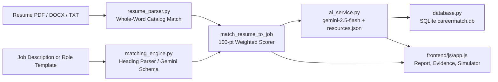

# CareerMatch AI

Resume-to-job requirement matcher and learning roadmap builder for students and early-career software/data engineers.


**Quick demo:** Upload [`samples/sample_resume_aarav_sharma.txt`](samples/sample_resume_aarav_sharma.txt) and paste [`samples/sample_jd_data_engineer.txt`](samples/sample_jd_data_engineer.txt) (or click **Load sample Data Engineer JD**) to get a **65.0% match** (4 of 6 mandatory skills matched: Python, SQL, AWS, Git; Apache Spark flagged as an adjacent skill at 0 pts; Data Warehousing and Kafka flagged as missing).

---

## Demo

- **Live Demo:** [ADD: live demo link]
- **Demo Video (60–90s):** [ADD: 60-90s demo video link]

| Hero & Analyzer | Career Report & Score Breakdown |
| :---: | :---: |
|  |  |

| Skill Gaps & Evidence Table | Interactive Roadmap & Node Inspector | Mobile View |
| :---: | :---: | :---: |
|  |  |  |

---

## The Problem

Students applying for software and data roles routinely receive automated rejections without knowing which mandatory or preferred requirements were missing from their resume. Existing keyword scanners either inflate scores with arbitrary baselines or recommend generic courses without linking each job requirement back to a specific line of proof in the candidate's resume.

---

## What It Does

- **Multi-format resume parsing:** Extracts contact details, education, work experience, projects, certifications, and 38 cataloged technical skills from PDF (`PyPDF2`), DOCX (`python-docx`), or plain text.
- **Heading-aware JD requirement extraction:** Splits job descriptions into Mandatory, Preferred, and Optional tiers using section headings (`Mandatory Requirements`, `Preferred Qualifications`, `Optional / Bonus`) or Gemini structured JSON extraction (`response_schema`).
- **Explainable 100-point score breakdown:** Scores only verified matches across Mandatory Skills (60%), Preferred Skills (15%), Projects & Experience (15%), Education (5%), and Certifications (5%), with zero padded baselines.
- **Requirement-to-resume evidence table:** Displays every job requirement alongside its single status (`Detected`, `Adjacent skill`, or `Missing`), the exact quote from the JD, and the supporting line from the resume.
- **4-phase roadmap with SQLite progress tracking:** Builds a clickable skill tree with a sticky node inspector, completion checkboxes persisted to SQLite, and verified Free + Paid courses from `backend/resources.json`.
- **What-if score simulator & grounded bullet rewrites:** Lets users toggle missing skills to see exact point gains (`+60/N` mandatory, `+15/M` preferred) and rewrites existing resume bullets using Gemini (`gemini-2.5-flash`) or a deterministic fallback.
- **Multi-role comparison & privacy controls:** Compares the current resume across all 8 built-in industry role benchmarks and includes a **"Don't save my resume"** checkbox to bypass SQLite storage.

---

## How It Works



1. **Deterministic parsing first:** `backend/resume_parser.py` validates file magic bytes (`%PDF-`, `PK\x03\x04`), extracts text, and matches whole-word aliases against `KNOWN_SKILLS_CATALOG` (38 technical skills, 6 soft skills) while recording the exact sentence that proved each skill.
2. **Optional Gemini enrichment with catalog verification:** When `GEMINI_API_KEY` is set, `backend/ai_service.py` calls `gemini-2.5-flash` with a strict JSON `response_schema` for resume and JD extraction, then filters the output so only skills present in `KNOWN_SKILLS_CATALOG` and verified as whole words in the source text are kept.
3. **Deterministic scoring:** `match_resume_to_job()` in `backend/matching_engine.py` assigns each job requirement to exactly one bucket (`matchedSkills`, `partialSkills` for adjacent skills, or `missingSkills`) and computes the 100-point breakdown in pure Python.
4. **Curated learning resources & AI guidance:** Course links are loaded from `backend/resources.json` (32 skills with 1 Free and 1 Paid URL each; uncataloged skills fall back to `Search [skill] on roadmap.sh`), while Gemini generates the 3-stage plan, portfolio projects, and grounded bullet rewrites.
5. **Automatic fallback (`source: "template"`):** If `GEMINI_API_KEY` is empty, invalid, or rate-limited, every endpoint logs a warning and returns deterministic output labeled `SOURCE: TEMPLATE` in the UI badge so the app works offline.

---

## How the Score Is Calculated

Each job requirement is evaluated once and assigned a single status: **Matched** (full weight), **Adjacent** (candidate knows a related technology in `ADJACENT_SKILLS`, e.g., knowing `Flask` when `FastAPI` is required — **0 points credited**), or **Missing** (0 points). A resume with zero detected technical skills is capped at `5.0%`.

| Category | Weight | How Raw Score (0–100) Is Computed | Max Points |
| :--- | :---: | :--- | :---: |
| **Mandatory Skills** | 60% | `(matched_mandatory / total_mandatory) * 100` | 60.0 |
| **Preferred Skills** | 15% | `(matched_preferred / total_preferred) * 100` | 15.0 |
| **Projects & Experience** | 15% | `30 pts` per project (up to 60) + `40 pts` per internship/job (up to 40); `0` if 0 skills detected | 15.0 |
| **Education** | 5% | `100` if a degree pattern (`B.Tech`, `B.E.`, `B.Sc`, `M.Tech`, `MCA`, etc.) is detected, else `0` | 5.0 |
| **Certifications** | 5% | `50 pts` per extracted certification line (up to 100 for 2+ certifications) | 5.0 |

**Readiness thresholds (stored in `database.py` dashboard metrics):**
- **`>= 80%`**: `Industry Ready`
- **`65% – 79.9%`**: `Strong Foundation`
- **`< 65%`**: `Building Core Skills`

---

## Tech Stack

| Layer | Technology | Version | Purpose |
| :--- | :--- | :--- | :--- |
| **Backend API** | Python + FastAPI + Uvicorn | `0.115.6` / `0.34.0` | REST endpoints, static file serving, security headers (`main.py`) |
| **AI Service** | Google GenAI SDK (`google-genai`) | `1.5.0` | Structured JSON extraction & bullet rewrites with `gemini-2.5-flash` |
| **Document Parsing** | `PyPDF2` & `python-docx` | `3.0.1` / `1.1.2` | PDF page extraction and DOCX paragraph/table parsing |
| **Database** | SQLite (`sqlite3`) | Built-in | Parameterized SQL storage for resumes, analyses, and roadmap progress |
| **Validation & Config** | `pydantic` & `python-dotenv` | `2.10.5` / `1.0.1` | Payload validation and `.env` configuration loading |
| **Frontend** | HTML5, CSS3, Vanilla JS | ES6+ | Single-page UI, Fetch API client, score simulator, and roadmap tree |

---

## Quick Start

### Prerequisites
- **Python 3.10+**
- **Google Gemini API Key** *(Optional — if omitted, the app runs in deterministic `template` mode)*

### Windows (Command Prompt / PowerShell)
```bat
git clone [ADD: repo url]
cd careermatch-ai
python -m venv venv
venv\Scripts\activate
pip install -r requirements.txt
copy .env.example .env
uvicorn backend.main:app --reload --host 127.0.0.1 --port 8000
```
*(Or double-click `run_windows.bat` to run all setup steps and launch on `http://127.0.0.1:8000`.)*

### macOS / Linux
```bash
git clone [ADD: repo url]
cd careermatch-ai
python3 -m venv venv
source venv/bin/activate
pip install -r requirements.txt
cp .env.example .env
uvicorn backend.main:app --reload --host 127.0.0.1 --port 8000
```
Open `http://127.0.0.1:8000` in your browser (or `http://127.0.0.1:8000/docs` for FastAPI Swagger UI).

---

## Environment Variables

| Variable | Required | Default | Description |
| :--- | :---: | :--- | :--- |
| `GEMINI_API_KEY` | No | `""` (empty) | Google Gemini API key from [Google AI Studio](https://aistudio.google.com/app/apikey). Leave empty to run in deterministic template mode. |
| `DATABASE_PATH` | No | `careermatch.db` | File path for the local SQLite database created on startup. |
| `PORT` | No | `3000` (`app.py`) / `8000` (`.env.example`) | Port used when starting via `python3 app.py` or `python3 -m backend.main`. |

---

## Project Structure

```text
careermatch-ai/
├── app.py                        # Root entry point with dependency bootstrapper; delegates to backend.main
├── backend/
│   ├── __init__.py               # Backend package marker
│   ├── main.py                   # FastAPI routes, ThreadingHTTPServer fallback, and static file mounting
│   ├── matching_engine.py        # 8 role templates, JD heading parser, 100-pt scorer, and roadmap node builder
│   ├── resume_parser.py          # PDF/DOCX/TXT extraction, 38-skill catalog, whole-word matcher, section parser
│   ├── ai_service.py             # Gemini 2.5 Flash calls, response_schema verification, and template fallbacks
│   ├── database.py               # SQLite schema (resumes, analyses, roadmap_progress) and parameterized queries
│   └── resources.json            # 32 curated skills with verified Free & Paid course URLs and subtopics
├── frontend/
│   ├── index.html                # Single-page application markup (Hero, Analyzer, 5-tab Career Report)
│   ├── css/
│   │   └── styles.css            # Responsive dark cosmic theme, score rings, roadmap tree, and tables
│   └── js/
│       └── app.js                # Vanilla JS state management, Fetch API calls, score simulator, and DOM rendering
├── samples/
│   ├── sample_resume_aarav_sharma.txt  # Sample B.Tech CS student resume for instant testing
│   └── sample_jd_data_engineer.txt     # Sample Data Engineer JD with Mandatory, Preferred, and Optional sections
├── docs/
│   └── screenshots/
│       └── README.txt            # Checklist of the 5 screenshots referenced in this README
├── requirements.txt              # Pinned Python dependencies
├── .env.example                  # Environment variable template (safe empty defaults)
├── run_windows.bat               # One-click Windows virtual environment setup and Uvicorn launcher
└── LICENSE                       # MIT License
```

---

## API Reference

| Method | Path | Purpose |
| :--- | :--- | :--- |
| `GET` | `/api/health` | Health check returning `{"status": "ok", "stack": "Python + FastAPI + SQLite + Google Gemini"}`. |
| `GET` | `/api/bootstrap` | Returns the 8 role templates, 3 sample resumes, default weights, sample JD text, and dashboard metrics. |
| `GET` | `/api/dashboard` | Returns analysis history and aggregate stats for a specific `resumeId` query parameter. |
| `POST` | `/api/resume/parse` | Parses base64-encoded file bytes (`PDF`/`DOCX`/`TXT`) or `pastedText`; respects `dontSave`. |
| `POST` | `/api/resume/upload` | Multipart file upload endpoint (`UploadFile`) that parses and saves a resume profile. |
| `POST` | `/api/analyze` | Runs resume-to-JD matching, 8-role comparison, roadmap generation, and Gemini/template recommendations. |
| `PUT` | `/api/resume/skills` | Updates a saved candidate's `technicalSkills` list in SQLite (`resumes` table). |
| `PUT` | `/api/roadmap/progress` | Persists completed roadmap node checkboxes (`completedNodes`) per `(resumeId, targetRole)`. |
| `GET` | `/api/history/{analysis_id}` | Reloads a previously saved analysis report from the `analyses` SQLite table. |
| `DELETE` | `/api/history/{analysis_id}` | Deletes a saved analysis record from SQLite and returns updated dashboard metrics. |

---

## Running the Tests

Verify that all Python modules compile cleanly with zero syntax errors:
```bash
python3 -m py_compile app.py backend/__init__.py backend/database.py backend/resume_parser.py backend/matching_engine.py backend/ai_service.py backend/main.py
```

Run a quick functional smoke test of the deterministic parser and scoring engine on the sample files:
```bash
python3 -c "
from backend.resume_parser import parse_resume_text_to_profile
from backend.matching_engine import resolve_job_profile, match_resume_to_job
res = parse_resume_text_to_profile(open('samples/sample_resume_aarav_sharma.txt').read(), 'sample.txt')
job = resolve_job_profile('Data Engineer', 'NexusCloud Commerce India', open('samples/sample_jd_data_engineer.txt').read())
m = match_resume_to_job(res, job)
assert m['overallScore'] == 65.0 and m['mandatorySatisfiedPct'] == 67
print('Smoke test passed:', m['overallScore'], '% match')
"
```

---

## Privacy and Data

Uploaded files are validated in memory (10 MB size cap, `%PDF-` and `PK\x03\x04` signature checks, executable binary rejection, and HTML/control-character sanitization). By default, parsed resumes and analysis history are stored locally in `careermatch.db` (ignored by Git via `.gitignore`). Checking **"Don't save my resume"** in the analyzer skips writing to `resumes`, `analyses`, and `roadmap_progress` in SQLite. When `GEMINI_API_KEY` is configured, resume text (up to 15,000 chars), JD text (up to 12,000 chars), and extracted bullets are sent to Google's Gemini API wrapped in `<untrusted_user_data>` delimiters.

---

## Known Limitations

- **Scanned image PDFs are not supported:** `PyPDF2` extracts embedded text streams only; scanned PDFs without an OCR text layer are rejected with an error prompting the user to upload a text-based PDF, DOCX, or paste plain text.
- **Fixed catalog of 38 technical skills:** Skill detection and JD requirement matching only recognize the **38** canonical skills and aliases defined in `KNOWN_SKILLS_CATALOG` (plus **6** soft skills in `SOFT_SKILLS_CATALOG`). Niche frameworks outside the catalog are ignored until added.
- **English-only section & heading heuristics:** Section detection (`EDUCATION`, `PROJECTS`, `CERTIFICATIONS`) and JD tier classification (`Mandatory`, `Preferred`, `Optional`) rely on English keywords.
- **Deterministic vs. AI steps:** Numeric compatibility scores (`match_resume_to_job`), adjacent skill mapping (`ADJACENT_SKILLS`), and course links (`backend/resources.json`) are 100% deterministic. Gemini (`gemini-2.5-flash`) is used for structured JD/resume extraction (verified against the catalog), the 3-stage learning narrative, project ideas, and bullet rewrites.
- **Course resource coverage:** `backend/resources.json` contains verified Free and Paid URLs for **32** skills; the remaining 6 catalog skills (`MongoDB`, `Redis`, `Network Security`, `SIEM & SOC`, `OWASP & AppSec`, `IAM & Cryptography`) or custom topics fall back to `Search [skill] on roadmap.sh`.

---

## Roadmap

1. **OCR fallback for scanned resumes:** Integrate optional `pypdfium2` + Tesseract or Gemini multimodal document reading when `PyPDF2` extracts fewer than 20 characters.
2. **Automated `pytest` suite in `tests/`:** Add unit tests covering PDF/DOCX edge cases, heading-based JD tiering, disjoint skill statuses, and API route status codes.
3. **Interactive side-by-side evidence highlighting:** Upgrade the Evidence table so clicking a JD requirement scrolls to and highlights the exact line inside the raw resume preview.
4. **Per-gap bullet rewriter with response caching:** Add an on-demand endpoint to rewrite a single chosen resume bullet for a specific gap skill and cache Gemini responses by a SHA-256 hash of `(resume_text + jd_text)`.
5. **Expand `KNOWN_SKILLS_CATALOG` and `resources.json`:** Add aliases and verified courses for mobile (`Flutter`, `React Native`, `Kotlin`), Go, Rust, and Terraform.

---

## Team, License & Acknowledgements

- **Team:** [ADD: names, roles, links]
- **License:** Distributed under the [MIT License](LICENSE).
- **Acknowledgements:** Built for **Graviton 2026** using the [Google Gemini API (`google-genai`)](https://ai.google.dev/), [FastAPI](https://fastapi.tiangolo.com/), and community learning paths referenced from [roadmap.sh](https://roadmap.sh/).
